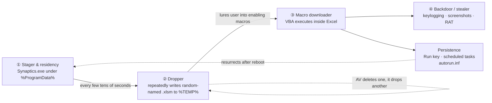

# OMacro/Downloader: Threat Advisory and Self-Check Removal Guide

<p align="right">
  <a href="README.md"><kbd>简体中文</kbd></a>
  <a href="README.en.md"><kbd>🌐 English</kbd></a>
</p>

> A macro downloader masquerading as a Synaptics touchpad driver · A threat advisory for end users and security practitioners
> **For defense, self-check and removal only. It contains nothing that can be used for attack.**

| Item | Detail |
|---|---|
| Document type | Malware advisory / self-check and removal guide |
| Detection name | `OMacro/Downloader.axn` (naming used by Huorong and other Chinese AV vendors) |
| Aliases used | `Synaptics.exe`, `Synaptics Pointing Device Driver` |
| Threat type | Trojan-Downloader + macro dropper + backdoor component |
| Affected platform | Microsoft Windows (32/64-bit); depends on Microsoft Office macro functionality |
| Privilege required | Runs with standard user rights; impact escalates sharply after privilege escalation |
| Risk level | High (credential theft and remote control) |
| Status | Compiled from public intelligence and hands-on logs; continuously revised |
| Last updated | 2026-11-18 |
| License | [CC BY 4.0](LICENSE) |

---

## Quick Self-Check

If you are not going to read the whole document, check these three things. **If any one of them matches, go straight to [Section 7](#7-safe-removal-procedure).**

| # | Where to look | Danger sign |
|---|---|---|
| 1 | File `C:\ProgramData\Synaptics\Synaptics.exe` | Present, and has no valid digital signature |
| 2 | Registry `Run` keys / startup entries | An entry named `Synaptics Pointing Device Driver` pointing into `%ProgramData%` |
| 3 | `%LOCALAPPDATA%\Temp` | Randomly named 8-character `.xlsm` files keep appearing (e.g. `CA4qyrZW.xlsm`) |

> The only valid criterion for "removal complete" is **whether the process is still running**, not whether the file was deleted.

---

## Contents

- [Quick Self-Check](#quick-self-check)
- [1. Overview](#1-overview)
- [2. Type and Scope](#2-type-and-scope)
- [3. Distribution Vectors](#3-distribution-vectors)
- [4. Infection Symptoms](#4-infection-symptoms)
- [5. Impact Analysis](#5-impact-analysis)
- [6. Identification](#6-identification)
- [7. Safe Removal Procedure](#7-safe-removal-procedure)
- [8. Post-Removal Verification](#8-post-removal-verification)
- [9. Prevention](#9-prevention)
- [10. Disclaimer](#10-disclaimer)
- [Appendix A: Anatomy of a Real Interception Log](#appendix-a-anatomy-of-a-real-interception-log)
- [Appendix B: Glossary](#appendix-b-glossary)
- [Appendix C: References](#appendix-c-references)
- [Appendix D: IOC Quick Reference](#appendix-d-ioc-quick-reference)

---

## 1. Overview

This is a **multi-stage malicious program** operating on Windows. It impersonates a touchpad driver from Synaptics (`Synaptics.exe`), resides in `C:\ProgramData\Synaptics\`, and continuously drops Excel workbooks containing VBA macros (`.xlsm`) into the system temp directory. Those workbooks are not spreadsheets meant for humans — they are **downloaders**: once a user opens one and allows macros to run, the macro code fetches further payloads and writes persistence entries, turning a one-off infection into long-term residency.

Antivirus products usually catch only the `.xlsm` that gets dropped, at the instant it lands, and report it under the `OMacro/Downloader` macro-virus family name. **The most common misjudgment here is this**: the log says "handled, file deleted", the user assumes it is over — but what was deleted was a single bullet, while the gun that fired it is still running in memory and will fire another one within minutes.

### Why the name "Synaptics" is the tell

Synaptics is a real touchpad and biometric hardware vendor. Its legitimate components live in:

```
C:\Program Files\Synaptics\SynTP\
```

The malicious sample instead uses:

```
C:\ProgramData\Synaptics\Synaptics.exe
```

`C:\ProgramData` is a **public directory writable by any logged-on user**. No legitimate driver vendor puts a boot-start driver executable there. Microsoft, Trend Micro and others have publicly documented the `%ProgramData%\Synaptics\Synaptics.exe` side-loading path, together with the matching startup entry named `Synaptics Pointing Device Driver` — a name that sounds perfectly normal, but points to an unsigned executable.

### On family attribution

Public intelligence shows the sample's behavior set overlaps heavily with the **XRed** family: masquerading as `Synaptics.exe`, dropping under `C:\ProgramData\Synaptics`, writing a registry `Run` key for persistence, injecting VBA into Excel files, spreading via `autorun.inf` on USB drives, collecting host information, and supporting remote commands.

To be explicit: **this document does not claim the sample is identical to XRed.** The same path and naming trick is reused by multiple groups, and a single interception log cannot determine the specific variant or attribution. Every "verdict" in this document is labeled with a confidence level — cross-validate against your own environment.

### What this document can and cannot do

- **Can**: help you determine whether your machine is compromised, remove it safely, verify that removal succeeded, and lower the chance of reinfection.
- **Cannot**: replace professional incident response (IR); guarantee coverage of every variant; or represent any vendor's official conclusion.
- **Explicitly excluded**: sample construction methods, macro code, C2 communication details, and evasion or detection-bypass techniques. This document describes **only what is observable from the defensive side**.

---

## 2. Type and Scope

### 2.1 Layer breakdown

| Layer | Role | Description |
|---|---|---|
| Layer 1 | Stager and residency | Driver-impersonating executable responsible for residency and autostart |
| Layer 2 | Dropper | Continuously generates macro-enabled `.xlsm` files into the temp directory |
| Layer 3 | Macro downloader | Macro code executes inside the Office process and downloads further payloads |
| Layer 4 | Backdoor / stealer | Keylogging, screenshots, remote commands, data exfiltration |



From a defensive standpoint, layers 1 and 3 are the **two points that must be cleaned together**. Cleaning only the temp files is mopping the floor while the tap is still running.

### 2.2 Scope

**Affected systems**

- Windows 7 / 10 / 11 and their Server counterparts, both 32-bit and 64-bit
- Standard user accounts on machines where `%ProgramData%` is writable — no administrator rights required
- Environments with Microsoft Office installed **and macros permitted** carry significantly higher risk

**High-risk populations**

- Users who have installed "cracked", "portable" or "activation tool" software
- Users who download peripheral drivers or peripheral configuration software (mouse, keyboard, printer, docking station, capture card) from unofficial channels
- Office workers, students and administrative staff who routinely open Excel/Word attachments from strangers
- Users who shuttle files between machines on USB drives

**Scenarios at relatively low risk**

- Environments where macros are fully disabled and untrusted Office documents are never opened — the macro download chain is cut
- Endpoints under strict application whitelisting (e.g. WDAC/AppLocker)
- Native Linux / macOS systems are not in this sample's direct attack surface, though cross-platform variants cannot be ruled out

**Organizational impact**

Inside a corporate network, the concern is not a single machine: leaked credentials create lateral-movement risk, and macro-injected Excel files keep propagating as "internal email", potentially triggering data-security and compliance obligations.

---

## 3. Distribution Vectors

One point must be clear up front: **this sample does not rely on a 0-day vulnerability.** It works by getting the user to run it, or to click "Enable Content". Its propagation logic is closer to social engineering than to technical exploitation.

### 3.1 Disguised as a hardware driver or peripheral utility

Attackers bundle the malicious program into a "driver installer", sometimes with a genuine-looking setup wizard. The user believes they installed touchpad, printer or gaming-peripheral software, but installed a backdoor alongside it. This is the family's most typical entry point.

### 3.2 Bundled with cracked software and activation tools

Cracks, keygens and "one-click activation" tools usually require users to disable antivirus and run as administrator. That lowers the user's guard and removes the only line of defense that might have stopped it.

### 3.3 Macro-enabled Office documents

`.xlsm` / `.xls` / `.docm` files in email attachments, group-chat files, cloud-drive shares and forum resources. After opening, the document often shows a blank sheet or "content disabled", nudging the user to click the yellow "Enable Content" bar at the top — **that click is the execution authorization**.

### 3.4 USB drives and removable media

By writing `autorun.inf`, it attempts to auto-execute a copy of itself when plugged into a new machine. This is an "old-school" but still effective technique, especially in shared-device settings such as campuses, print shops and computer labs.

### 3.5 Secondary spread through already-infected local files

The sample injects VBA code into existing Excel files on the host. That means **your own spreadsheets may already be contaminated**; sending them to a colleague or uploading them to a group chat turns them into new propagation sources. This is the most frequently overlooked part of cleanup.

---

## 4. Infection Symptoms

Ordered by strength of evidence, strongest first. Multiple hits together essentially confirm infection.

### 4.1 Strong signals (near-conclusive)

- An AV log entry where `%ProgramData%\Synaptics\Synaptics.exe` appears as the **acting process**
- `C:\ProgramData\Synaptics\Synaptics.exe` exists on the system drive and **lacks a valid Synaptics digital signature**
- A registry `Run` value named `Synaptics Pointing Device Driver` pointing to that path
- Randomly named 8-character `.xlsm` files appearing repeatedly in the temp directory within a short window (e.g. `CA4qyrZW.xlsm`, `gdLblOSg.xlsm`), each containing `xl/vbaProject.bin`

### 4.2 Moderate signals (need corroboration)

- A `Synaptics.exe` process exists in Task Manager, but the machine has no Synaptics touchpad or fingerprint hardware
- The process's parent has already exited, or the parent is an implausible program such as a browser, archive tool or Office
- The process's file path no longer exists on disk (self-deleted but still running in memory)
- Unexpected scheduled tasks, services, or Startup-folder shortcuts
- The process connects to unfamiliar overseas IPs, or holds idle connections for long periods

### 4.3 Weak signals (may have other causes; indicative only)

- A blank Excel window or the "Document Recovery" pane pops up after boot
- Excel says "this document contains macros" although you never created any
- Sustained high CPU or disk usage while idle
- Browser warnings about abnormal logins, or account logins from unfamiliar locations
- `autorun.inf` or unknown `.exe` files appearing on USB drives

### 4.4 One easily misjudged phenomenon

An AV message saying "handled / file deleted" **does not mean the threat is gone**. Always check the "acting process" field of the same log entry — if that process is still running, the deletion is only temporary. The criterion should be "does that process still exist", not "has the file been deleted".

---

## 5. Impact Analysis

### 5.1 Credential and privacy exposure

Common capabilities include keylogging, clipboard monitoring, screen capture and host information collection (computer name, username, MAC address, etc.). Passwords typed on that machine, chat content, and copied verification codes may already have leaked.

### 5.2 Remote control

The backdoor component typically accepts remotely issued commands, enabling file upload/download, command execution and directory listing. The attacker does not need to be online at the moment of infection — they can take over at any point before you shut down.

### 5.3 Persistence and anti-forensics

- **Autostart**: writes a registry `Run` key so it comes back after reboot
- **Self-deletion**: deletes its own on-disk copy after staging, while the process keeps running in memory, defeating file-scan-based investigation
- **Multiple copies**: several drop locations exist at once, so removing one does not affect the whole
- **Abuse of legitimate signing**: some variants use stolen or misused code-signing certificates to lower static detection rates

### 5.4 Lateral spread

Macro-injected Office files spread to other devices via email, group chats and USB drives. For an organization, one compromised endpoint can become a compromised segment.

### 5.5 Business and compliance impact

- Lateral movement enabled by leaked internal credentials
- Sensitive documents exfiltrated
- If personal or business data is involved, compliance reporting obligations may be triggered

### 5.6 A necessary expectation to set

After removal you **must not assume "nothing happened"**. What the malware did during residency has to be assessed against network logs and account login records. That is why password changes are listed as mandatory in the removal procedure below, not optional.

---

## 6. Identification

Everything below is **read-only inspection** — no system modification. Follow the order given.

### 6.1 Start with the "acting process" in AV logs

Open your security product's logs and inspect the details of each blocked event. Focus on:

- **Acting process**: is it a normal program? Is its path outside `Program Files`?
- **Malware path**: is it under writable directories such as `%TEMP%`, `%APPDATA%`, `%ProgramData%`?
- **Operation type**: `Modify` (the process is rewriting the file, not merely opening it) is more alarming than `Create`

### 6.2 Verify path and signature

| Dimension | Legitimate component | Suspicious / malicious |
|---|---|---|
| Location | `C:\Program Files\Synaptics\SynTP\` | `C:\ProgramData\Synaptics\`, `%TEMP%`, `%APPDATA%` |
| Digital signature | Valid, signed by Synaptics or an OEM | Unsigned, invalid, or signer inconsistent with the product |
| File properties | Product name, version and company are consistent | Description claims a driver, but company field is empty or odd |
| Hardware corroboration | The corresponding hardware exists in Device Manager | The process exists but the hardware does not |

**Note**: filenames and descriptions can both be forged. Only "path + signature + hardware context" taken together has diagnostic value.

### 6.3 Inspect process relationships

In Task Manager's "Details" tab, check the PID and parent PID:

- Parent already exited while the child lives on — the classic "drop and self-terminate" structure
- Parent is a browser, archive tool or Office — an implausible launch chain
- The file the process path points to no longer exists — self-deletion behavior

### 6.4 Inspect autostart entries

Microsoft's official Autoruns (Sysinternals) exposes far more autostart locations than Task Manager, including Run, RunOnce, scheduled tasks, services and the Startup folder. Look for:

- Entries named like drivers but pointing into user-writable directories
- Entries with highly generic names (e.g. `system`, `update`, `svchost`) but abnormal paths
- Leftover entries pointing to files that no longer exist

### 6.5 Inspect the temp directory

Check `%LOCALAPPDATA%\Temp` for:

- Documents named with 8 random characters plus `.xlsm` / `.xls`
- Multiple similar files whose modification times cluster within a few minutes
- Spreadsheets of similar size and naming style that are blank inside

### 6.6 Inspect network behavior

Use Resource Monitor or `netstat` to check a suspicious process's connections. Interpret with care:

- **No** connections do **not** mean safe (it may be dormant or beaconing on demand)
- If connections exist, correlate the destination IP's geolocation, port, and whether it belongs to a service you know

### 6.7 Hash comparison

Compute a hash of the suspicious file and look it up on public platforms such as VirusTotal. **Before submitting, confirm the file contains no personal or business data**; for Office documents, prefer scanning locally with your AV and do not upload them.

### 6.8 How to write up your findings

In your self-check notes, explicitly separate three tiers so that speculation is not mistaken for fact:

- **Confirmed**: direct evidence (path, signature, log, process)
- **Highly suspicious**: multiple indirect signals agree, but decisive evidence is missing
- **Under observation**: a single weak signal, needs continued monitoring

### 6.9 Exclusion first: make sure it is not a legitimate component

The indicators in this document are highly specific, but judging by "path + process name" alone leads to false positives easily — and deleting a legitimate driver breaks touchpad or fingerprint functionality. The following cases are usually **not** this family, and should be excluded first:

| Observation | More likely explanation | Next step |
|---|---|---|
| Located in `C:\Program Files\Synaptics\SynTP\`, signed by Synaptics or a laptop OEM | Legitimate touchpad driver | Confirm the matching hardware in Device Manager |
| Process present and Device Manager really does show Synaptics touchpad/fingerprint hardware | Legitimate preinstalled component | Verify signer and version — that is enough |
| Only the filename is `Synaptics.exe`, sitting in Downloads or on the Desktop | Leftovers from a manually downloaded driver package | Check the signature; recall whether you installed it |
| `.xlsm` files in `%TEMP%`, but with business-meaningful names (e.g. `Quote2026Q1.xlsm`) | Your own work files | Check for macros of unknown origin |
| Valid signature present, but no matching hardware | Remnants of an OEM universal driver package | Judge by startup entries and network behavior |
| Outbound connections exist, but targets are known update servers | Normal software update | Verify domain ownership |

**Decision rule**: this document's strong signal requires **all three** of "path + no signature + startup entry pointing to it" — not any single one. **A filename of `Synaptics.exe` alone is nowhere near enough to declare an infection.**

One more caution: after uninstalling a legitimate touchpad driver, some laptops lose gestures, scrolling, or even the cursor, and recovery requires reinstalling the OEM driver. **Verify before deleting, and back up before verifying.**

---

## 7. Safe Removal Procedure

> Precondition: if this machine touches a corporate network, finance systems, development certificates or large volumes of customer data, **contact a professional or your IT department first** and do not handle it yourself. The procedure below is for personal devices.

### Stage 0: Preparation (do not skip)

1. **Stop using the machine for anything sensitive**: no online banking, email or corporate systems
2. **Disconnect from the network**: unplug Ethernet, turn off Wi-Fi. The goal is to cut beaconing and secondary downloads, not to "fix" anything
3. **Back up important data to another device**: back up documents and photos only — **do not back up executables, scripts or macro-enabled Office files**
4. **Record the current state**: screenshot AV logs, the process list and startup entries for later reference

### Stage 1: Move to a clean environment

In normal mode the malicious process may self-protect and rebuild itself immediately after deletion. Work in **Safe Mode** instead:

- Prefer your AV's "boot-time / pre-boot scan" or rescue-disk feature
- Otherwise enter Safe Mode through Windows settings (the entry point differs by Windows version — follow the on-screen prompts)

### Stage 2: Scan with a trusted security product

1. Run a **full scan** with a trustworthy antivirus, not just the system drive
2. Cover: system drive, `C:\ProgramData`, `%LOCALAPPDATA%\Temp`, Desktop, Downloads, Documents, and all removable storage
3. If your vendor offers a dedicated removal tool for this family, use it first
4. **Do not stop after rebooting** once the scan completes — continue with Stage 3's manual verification

### Stage 3: Manually verify leftovers

AV removes "the files it recognizes"; leftover startup entries and empty directories need manual confirmation:

| Location | What to do |
|---|---|
| Process list | End every process whose path points into `C:\ProgramData\Synaptics\` |
| File directories | Confirm `C:\ProgramData\Synaptics\` is empty; if AV deleted only the exe, handle the directory too |
| Registry Run keys | Delete entries pointing to that path, plus suspicious entries whose targets no longer exist |
| Scheduled tasks | Delete entries with driver-related names that actually run programs from user directories |
| Services | Check for services pointing into user-writable directories |
| Startup folder | Check `shell:startup` and the common Startup folder for anomalous shortcuts |
| Temp directory | Clean out all `.xlsm` / `.xls` / `.docm` files of unknown origin under `%LOCALAPPDATA%\Temp` |

**Always export a backup before modifying the registry** (right-click the key → Export) so a mistaken deletion can be undone. Do not delete entries you are unsure about — record them first and decide later.

### Stage 4: Handle contaminated Office files

1. When opening any Office document, **never click "Enable Content / Enable Macros"**
2. Inspect the `.xlsm` / `.docm` files you use regularly: do they contain macros you never wrote? Do they prompt to save when you made no changes?
3. For files you cannot confirm as clean, re-obtain them from backups, cloud-drive version history or the original email; purely tabular data can be copied into a fresh plain `.xlsx`
4. In Office Trust Center, set macros to "Disable all macros with notification", and remove unnecessary directories from "Trusted Locations"

### Stage 5: Handle accounts and credentials

Treat it as a leak, not as "probably fine":

1. From **a different, clean device**, change passwords for important accounts: email, online banking/payments, social media, code hosting, cloud services
2. Enable two-factor authentication (SMS, TOTP, hardware key)
3. Review each account's login history and authorized applications; revoke sessions and tokens you do not recognize
4. For development environments, rotate API keys, SSH keys and cloud platform access keys

### Stage 6: Decide whether to reinstall

If any of the following applies, **reinstall the operating system** rather than cleaning repeatedly:

- The infection went unnoticed for a long time (e.g. logs show it was present months ago)
- The machine holds high-value credentials or business data
- Anomalous processes or outbound connections persist after cleanup
- You cannot confirm all drop locations and persistence points

Reinstall from an official image; after reinstalling, change passwords first, then restore data (documents only).

---

## 8. Post-Removal Verification

Cleanup is not the end. Confirm each item below and maintain a 3–7 day observation window.

| # | Check | Expected result | How to verify |
|---|---|---|---|
| 1 | Processes | No process pointing into `C:\ProgramData\Synaptics\` | Task Manager / process list |
| 2 | Files | `C:\ProgramData\Synaptics\` no longer exists or is empty | Explorer (with hidden files shown) |
| 3 | Temp directory | No new random-named `.xlsm` over consecutive checks | Sort by modification time |
| 4 | Autostart | No Run / RunOnce / Startup entries for that path | Re-check with Autoruns |
| 5 | Scheduled tasks | No related tasks | Task Scheduler |
| 6 | Services | No services pointing into user-writable directories | Services console |
| 7 | Full scan | Trusted AV full scan reports no threats | Cross-check with at least two engines |
| 8 | Network | No anomalous outbound connections; no anomalies while offline | Resource Monitor |
| 9 | Office | No macro-enable prompts when opening documents; macro policy tightened | Office Trust Center |
| 10 | Accounts | Passwords changed, 2FA enabled, no anomalous logins | Each platform's security center |

**Observation window**: for 3–7 days after cleanup, re-check items 1, 3 and 4 after each boot. If files or processes at the same path reappear, an undiscovered persistence point exists and you should switch to the reinstall plan.

---

## 9. Prevention

### 9.1 For individuals

- **Get drivers only from the vendor's official site or Windows Update** — avoid third-party "driver packs" and "driver updater" tools
- **Do not use cracked software, keygens or activation tools.** They require disabling antivirus, which is itself the highest-risk configuration
- **Keep Office macros disabled by default**, and adopt a "never enable" habit for documents of unknown origin
- **Disable USB autorun**; scan unfamiliar USB drives before opening them
- **Use a standard account day to day**; do not run as administrator permanently
- **Follow 3-2-1 backup** for important data (three copies, two media types, one offline)
- Keep Windows and Office patched, and run a full scan periodically

### 9.2 For organizations

- Application whitelisting (WDAC / AppLocker) that blocks execution from `%TEMP%`, `%APPDATA%` and `%ProgramData%`
- Deploy EDR with alerts on "Office child process creates an executable" and "Office makes outbound connections"
- Disable macros organization-wide via Group Policy, allowing only signed, trusted templates
- Restrict write access for peripherals and removable storage
- Vet "driver-type" installers at the gate, especially peripheral vendors' configuration software
- Monitor endpoints for anomalous outbound connections and credential anomalies

### 9.3 The single most effective recommendation

If you can do only one thing: **set Office macros to disabled by default, and never click "Enable Content".** Most of this family's destructive potential depends on the user clicking that one button.

---

## 10. Disclaimer

1. This document is **defensive technical material** intended to help users identify, remove and prevent this type of malicious program. It is not a complete analysis report on any specific sample.
2. Content is compiled from public threat intelligence, vendor documentation and hands-on logs. Malware variants iterate quickly and actual behavior may differ from what is described here; **no guarantee is made regarding detection rates or removal effectiveness**.
3. Detection names mentioned here (such as `OMacro/Downloader.axn`) belong to specific vendors' naming schemes. Different vendors may name the same sample differently, and a name does not by itself indicate sample attribution.
4. Judgments about family attribution (such as XRed) are **analytical inferences based on behavioral characteristics** and are not equivalent to vendor conclusions or judicial findings.
5. Removal operations involve ending processes, deleting files and modifying the registry — system-level changes that carry risks of mistaken deletion and system instability. **Always back up before acting; you assume the risk.** If you lack the relevant experience, seek professional assistance.
6. This document **does not provide** code, samples or operational details that could be used to create, spread, escalate privileges with or evade detection of malware. Any use of this content for offensive purposes is unrelated to the author.
7. In enterprise environments, remediation should be carried out by a qualified security services team. This document does not replace a formal incident response process.
8. Product names, company names and trademarks mentioned here belong to their respective owners and are used solely for technical description and identification.

---

## Appendix A: Anatomy of a Real Interception Log

Below is an actual interception record (sanitized), usable as a reference sample during self-checks.

> **Note on timestamps**: `2026/11/18 12:01:57` in the log is the **actual time the event occurred (the interception)**, which is a different concept from this document's "Last updated" date. The former locates the environment and version at that moment; the latter only marks the most recent revision of this document. When this document is revised later, the log timestamp stays unchanged.

**AV log summary**

```
Time          : 2026/11/18 12:01:57
Category      : Virus protection
Feature       : File real-time monitoring
Summary       : Virus OMacro/Downloader.axn found, handled

Virus name    : OMacro/Downloader.axn
Virus path    : C:\Users\<username>\AppData\Local\Temp\CA4qyrZW.xlsm
Operation     : Modify
Result        : Handled, file deleted
Acting process: C:\ProgramData\Synaptics\Synaptics.exe
Parent PID    : 9488 (exited)
```

**Field-by-field reading**

| Field | Meaning | Risk implication |
|---|---|---|
| `OMacro/Downloader.axn` | Office macro downloader | The macro code can download further payloads |
| Virus path in `%TEMP%` | Randomly named document in the temp directory | Legitimate business does not produce files this way |
| Operation "Modify" | The process is rewriting the file, injecting macros | More dangerous than "open" — active implantation |
| Acting process in `ProgramData` | A program pretending to be a driver | Legitimate drivers are not located there |
| Parent already exited | The dropper self-terminated after launching | A classic move to break the forensic chain |

**Three facts easily missed in this case**

1. The log says "deleted", but **the acting process was still running** and kept generating new files of the same kind within minutes (several differently named `.xlsm` files in the same window, only tens of seconds apart).
2. The process's executable **had disappeared from disk**, yet the process survived in memory — so searching for the file by path returns "nothing at all".
3. The system also had a startup entry pointing to `C:\Windows\system32\system.exe`, a file that does not exist — a persistence artifact of the same origin or an earlier leftover.

**Conclusion**: for incidents like this, "is the process still there" must be the criterion for completion — not "was the file deleted".

---

## Appendix B: Glossary

| Term | Explanation |
|---|---|
| Macro | An automation script written in VBA within Office, capable of executing code and system operations |
| Dropper | A component that writes malicious files to disk; not necessarily capable of full attack on its own |
| Downloader | A component that retrieves follow-on payloads from a remote source |
| Persistence | Ensuring execution survives reboot, via startup entries, services or scheduled tasks |
| Self-deletion | A program deleting its own on-disk copy to evade file scanning |
| IOC | Indicator of Compromise — an artifact indicating a possible intrusion |
| EDR | Endpoint Detection and Response — detection based on behavior rather than signatures alone |
| Application whitelisting | A security policy permitting only known programs to run |
| Mark of the Web | A tag Windows attaches to files originating from the internet, used to trigger Protected View |

---

## Appendix C: References

| Source | What it provides | Link |
|---|---|---|
| Trend Micro Threat Encyclopedia | Documents the startup entry `Synaptics Pointing Device Driver = %ProgramData%\Synaptics\Synaptics.exe` and the drop path, with manual removal steps | [Virus.Win32.NAPWHICH.E](https://www.trendmicro.com/vinfo/us/threat-encyclopedia/malware/Virus.Win32.NAPWHICH.E) |
| ANY.RUN threat intelligence | XRed behavior summary: masquerading, registry autostart, macro injection, USB spread, remote command set | [XRed](https://any.run/malware-trends/xred/) |
| Malpedia (Fraunhofer FKIE) | XRed profile: mutex name, DDNS domain, distribution methods, capability list | [XRed](https://malpedia.caad.fkie.fraunhofer.de/details/win.xred) |
| eSentire research blog | The original XRed analysis, source of the "Synaptics worm" alias | [XRed Backdoor](https://www.esentire.com/blog/xred-backdoor-the-hidden-threat-in-trojanized-programs) |
| Microsoft Learn | Blocking macros from running in Office files from the internet (Group Policy and registry) | [Macros from the internet are blocked](https://learn.microsoft.com/en-us/deployoffice/security/internet-macros-blocked) |
| Microsoft Sysinternals | Autoruns — comprehensive inspection of startup entries, scheduled tasks and services | [Autoruns](https://learn.microsoft.com/en-us/sysinternals/downloads/autoruns) |

> All links were verified reachable (HTTP 200) on 2026-11-18. Citations are for fact-checking only; defer to each vendor's original text for conclusions.

---

## Appendix D: IOC Quick Reference

Every item in the tables below comes from the body of this document and can be used directly for self-check comparison. **This document does not provide file hashes or C2 addresses** — that data is highly time-sensitive and should come from vendor intelligence sources; defer to VirusTotal or vendor IOC lists.

### D.1 Files and paths

| Type | Value | Note |
|---|---|---|
| Malicious process path | `C:\ProgramData\Synaptics\Synaptics.exe` | No valid Synaptics signature |
| Malicious directory | `C:\ProgramData\Synaptics\` | Legitimate vendors do not drop here |
| Drop directory | `%LOCALAPPDATA%\Temp\` | Random 8-character `.xlsm` / `.xls` |
| Genuine path for comparison | `C:\Program Files\Synaptics\SynTP\` | Where the real component lives |
| Leftover startup target | `C:\Windows\system32\system.exe` | File does not exist; residual artifact |
| USB spread files | `autorun.inf` plus a same-named `.exe` | Removable-media self-check item |

### D.2 Registry and startup locations

| Type | Value | Note |
|---|---|---|
| Autostart value name | `Synaptics Pointing Device Driver` | Malicious if it points into `%ProgramData%` |
| Autostart locations | `HKCU\...\Run`, `HKLM\...\Run`, `RunOnce` | Autoruns gives fuller coverage |
| Other persistence | Scheduled tasks, services, `shell:startup` folder | Names disguised as driver-related |

### D.3 File content and naming characteristics

| Characteristic | What to look for |
|---|---|
| Filename pattern | 8 random mixed-case letters + `.xlsm` (e.g. `CA4qyrZW.xlsm`, `gdLblOSg.xlsm`) |
| File content | Blank spreadsheet containing `xl/vbaProject.bin` |
| Generation cadence | Multiple files in the same window, only tens of seconds apart |
| Size and timestamps | Similar sizes, modification times clustered within minutes |

### D.4 Behavioral characteristics (for EDR / log review)

| Behavior | Detection approach |
|---|---|
| Process in a writable directory creates Office files | Writes to `.xlsm` from `%ProgramData%` or `%TEMP%` processes |
| Anomalous outbound from an Office child process | `EXCEL.EXE` initiating outbound connections |
| Drop and self-terminate | Process alive but its file is gone; parent already exited |
| Autostart writes | New `Run` values appearing outside of an installation event |

### D.5 Grading your conclusion

| Grade | Basis | Recommended action |
|---|---|---|
| Confirmed | Path + missing signature + log acting process all agree | Proceed to Section 7 immediately |
| Highly suspicious | Multiple moderate signals agree, no decisive evidence | Disconnect, full scan, capture process evidence |
| Under observation | A single weak signal only | Record it and observe for 3–7 days |

### D.6 Family traits from public intelligence (cross-validation only)

The items below come from public intelligence describing the **XRed** family and are **not conclusions about the sample observed in this document**. Use them only for cross-validation and for writing detection rules; they cannot establish attribution on their own. Their value rises considerably if they co-occur with the strong signals in Section 4 on your machine.

| Type | Value | Detection / response use |
|---|---|---|
| Mutex | `Synaptics2X` | Enforces a single instance; search with a mutex enumeration tool |
| Communication domain | `xred.mooo.com` | Hardcoded dynamic domain; block at DNS or firewall |
| USB propagation content | `autorun.inf` containing `open=Synaptics.exe`, `shellexecute=Synaptics.exe` | Removable-media self-check item |
| Macro drop in document folders | Hidden copy named `~$cache1` | Hunt for anomalous hidden files in document directories |
| Exfiltration method | Sends MAC address, username and computer name over SMTP | Alert on anomalous outbound SMTP |
| Remote command set | Screenshots, command-line access, disk listing, directory listing, file download, file deletion | EDR behavioral rule authoring |

**Why no file hashes are provided**

Hashes change rapidly across variants and are only useful when they correspond to an actual sample on a platform such as VirusTotal. Without a controlled sample source, this document **does not include any unverified hash** — a wrong hash is more dangerous than no hash, because it creates the illusion that a file has been cleared. When you need hashes, search VirusTotal or vendor IOC sources directly and verify file size and first-submission date.

---

**Maintenance note**: This is a living document. If you observe a new variant path, a new persistence location, or behavior that contradicts what is described here, please open an Issue so the identification and removal sections can be updated. Sanitize usernames, hostnames, IPs and other sensitive details from logs before submitting.

**This repository does not host and does not accept malicious samples.** If you must share a sample, provide only public intelligence platform links — do not upload binaries.

---

*This document is licensed under [CC BY 4.0](LICENSE). Attribution required for redistribution.*
