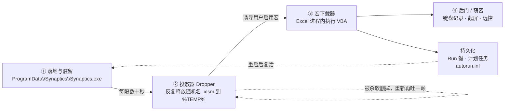

# OMacro/Downloader 威胁说明与自查清除指南

> 伪装成 Synaptics 触摸板驱动的宏下载器 · 面向普通用户与安全从业者的威胁说明
> **仅用于防御、自查与清除，不包含任何可用于攻击的内容。**

| 项目 | 内容 |
|---|---|
| 文档类型 | 恶意程序说明 / 自查与清除指南 |
| 检测名称 | `OMacro/Downloader.axn`（火绒等国产杀毒软件命名） |
| 使用化名 | `Synaptics.exe`、`Synaptics Pointing Device Driver` |
| 威胁类型 | 木马下载器（Trojan-Downloader）+ 宏投放器 + 后门组件 |
| 影响平台 | Microsoft Windows（32/64 位），依赖 Microsoft Office 宏功能 |
| 权限要求 | 普通用户权限即可运行，提权后危害显著放大 |
| 风险等级 | 高（涉及凭据窃取与远程控制） |
| 文档状态 | 基于公开情报与实测日志整理，持续修订 |
| 许可协议 | [CC BY 4.0](LICENSE) |

---

## 快速自查清单

不想读全文时，只需确认下面三件事。**命中任意一条，直接跳到[第七章](#七安全的清除步骤)。**

| # | 检查位置 | 危险信号 |
|---|---|---|
| 1 | 文件 `C:\ProgramData\Synaptics\Synaptics.exe` | 存在，且无有效数字签名 |
| 2 | 注册表 `Run` 项 / 启动项 | 存在名为 `Synaptics Pointing Device Driver`、指向 `%ProgramData%` 的条目 |
| 3 | `%LOCALAPPDATA%\Temp` | 反复出现随机 8 位文件名的 `.xlsm`（如 `CA4qyrZW.xlsm`） |

> 判断是否处置完成的唯一标准是**「那个进程还在不在」**，不是「文件有没有被删掉」。

---

## 目录

- [快速自查清单](#快速自查清单)
- [一、概述](#一概述)
- [二、类型与影响范围](#二类型与影响范围)
- [三、传播途径](#三传播途径)
- [四、感染症状](#四感染症状)
- [五、危害分析](#五危害分析)
- [六、识别方法](#六识别方法)
- [七、安全的清除步骤](#七安全的清除步骤)
- [八、清除后验证](#八清除后验证)
- [九、预防建议](#九预防建议)
- [十、免责声明](#十免责声明)
- [附录 A：一次真实拦截日志的解读](#附录-a一次真实拦截日志的解读)
- [附录 B：术语表](#附录-b术语表)
- [附录 C：参考资料](#附录-c参考资料)
- [附录 D：IOC 速查表](#附录-dioc-速查表)

---

## 一、概述

这是一类在 Windows 上活动的**多阶段恶意程序**。它把自己伪装成 Synaptics 公司的触摸板驱动（`Synaptics.exe`），常驻在 `C:\ProgramData\Synaptics\` 目录下，并持续向系统临时目录释放带 VBA 宏的 Excel 工作簿（`.xlsm`）。这些工作簿本身不是给人看的表格，而是**下载器**：一旦用户打开并允许宏运行，宏代码会继续下载后续载荷、写入自启动项，把一次性感染变成长期驻留。

杀毒软件通常只在文件落地的一瞬间抓到它释放出来的那个 `.xlsm`，报成 `OMacro/Downloader` 系列的宏病毒名。**这里最容易误判的地方是**：日志显示"已处理、删除文件"，用户以为事情结束了，实际上被删掉的只是它吐出的一颗子弹，开枪的进程仍然在内存中运行，并且会在几分钟内再吐一颗新的。

### 为什么"Synaptics"这个名字是破绽

Synaptics 是真实存在的触控板与生物识别硬件厂商，其正规组件位于：

```
C:\Program Files\Synaptics\SynTP\
```

而恶意样本使用的是：

```
C:\ProgramData\Synaptics\Synaptics.exe
```

`C:\ProgramData` 是**任何登录用户都可写入**的公共目录，正规硬件驱动厂商不会把需要开机自启的驱动主程序放在这里。微软、Trend Micro 等机构都公开记录过 `%ProgramData%\Synaptics\Synaptics.exe` 这一"借壳"路径，配套的自启动项名为 `Synaptics Pointing Device Driver`——名字听起来完全正常，但指向的是一份无有效签名的可执行文件。

### 家族归属的说明

从公开情报看，该样本的行为集合与 **XRed** 家族高度重合，包括：伪装为 `Synaptics.exe`、在 `C:\ProgramData\Synaptics` 下落地、写入注册表 Run 键实现自启、向 Excel 文件注入 VBA、通过 U 盘 `autorun.inf` 传播、收集主机信息并支持远程命令。

需要强调的是：**本文不宣称其与 XRed 完全等同**。同一路径与命名手法被多个团伙复用，仅凭单条拦截日志无法确定具体变种或归属。文档中所有"判定"结论均标注了置信度，请结合自身环境交叉验证。

### 本文能做什么、不能做什么

- 能：帮助你判断自己的机器是否中招、如何安全清除、如何验证清除干净、如何降低再次中招的概率。
- 不能：不能替代专业的事件响应（IR）服务；不保证覆盖所有变种；不代表任何厂商的官方结论。
- 明确不包含：样本构造方法、宏代码、C2 通信细节、免杀与绕过检测的技巧。本文只描述**防御侧可见的现象**。

---

## 二、类型与影响范围

### 2.1 类型拆解

| 层次 | 角色 | 说明 |
|---|---|---|
| 第一层 | 落地与驻留 | 伪装成驱动的可执行文件，负责常驻与自启动 |
| 第二层 | 投放器（Dropper） | 持续生成带宏的 `.xlsm` 文件到临时目录 |
| 第三层 | 宏下载器（Downloader） | 宏代码在 Office 进程中执行，下载后续载荷 |
| 第四层 | 后门 / 窃密组件 | 键盘记录、截屏、远程命令、信息回传 |



从防御视角看，第一层和第三层是**必须同时清理**的两个点。只清临时文件，等于只扫地不关水龙头。

### 2.2 影响范围

**受影响的系统**

- Windows 7 / 10 / 11 及对应 Server 版本，32 位与 64 位均可能受影响
- `%ProgramData%` 可写的普通用户账户同样可以被感染，不需要管理员权限
- 安装了 Microsoft Office 且**允许启用宏**的环境，风险显著升高

**高风险人群**

- 自行安装过"破解版""绿色版""激活工具"的用户
- 从非官方渠道下载外设驱动、外设配置软件（鼠标、键盘、打印机、扩展坞、采集卡）的用户
- 经常接收并打开陌生人发来的 Excel/Word 附件的办公人员、学生、行政岗位
- 使用 U 盘在多个设备间倒腾文件的用户

**相对不受影响的场景**

- 完全禁用宏、且不打开来源不明 Office 文档的环境，宏下载链会被切断
- 应用白名单（如 WDAC/AppLocker）严格管控的终端
- Linux / macOS 原生系统不在此样本的直接攻击面内，但不排除存在跨平台变种

**组织层面的影响**

一旦发生在企业内网，需要关注的不只是单机：凭据泄露会带来横向移动风险，被感染的 Excel 文件会作为"内部邮件"继续传播，可能触及数据安全与合规要求。

---

## 三、传播途径

需要先明确一点：**这类样本不依赖 0day 漏洞**。它靠的是让用户自己动手运行，或者让用户自己点"启用宏"。因此它的传播逻辑更接近社会工程，而不是技术攻击。

### 3.1 伪装成硬件驱动或外设软件

攻击者把恶意程序打包进"驱动安装包"，甚至配合真实的安装界面。用户以为自己装的是触摸板、打印机或游戏外设的配套软件，实际同时装了一个后门。这是该家族最典型的入口。

### 3.2 捆绑在破解软件与激活工具中

破解补丁、注册机、"一键激活"工具通常要求用户关闭杀软、以管理员身份运行。这既降低了用户警惕，也直接绕过了唯一可能拦截它的那道防线。

### 3.3 带宏的 Office 文档

邮件附件、群文件、网盘分享、论坛资源里的 `.xlsm` / `.xls` / `.docm`。文档打开后往往显示为空白表格或"内容已禁用"，诱导用户点击顶部黄色的"启用内容"按钮——**这一步就是授权执行**。

### 3.4 U 盘与移动存储

通过写入 `autorun.inf`，在接入新机器时尝试自动执行自身副本。这是相对"老派"但依然有效的手法，尤其在校园、打印店、机房这类共用设备场景。

### 3.5 已被感染的本机文件二次传播

样本会向本机已有的 Excel 文件注入 VBA 代码。这意味着**你自己做的表格可能已经被污染**，再发给同事或上传到群里，就变成了新的传播源。这是清除阶段最容易被忽略的一环。

---

## 四、感染症状

按"证据强度"从高到低排列。命中多条时，基本可以确认感染。

### 4.1 强信号（几乎可确诊）

- 杀软日志中出现 `%ProgramData%\Synaptics\Synaptics.exe` 作为**操作进程**的记录
- 系统盘存在 `C:\ProgramData\Synaptics\Synaptics.exe`，且该文件**没有有效的 Synaptics 数字签名**
- 注册表 `Run` 项中存在名为 `Synaptics Pointing Device Driver` 的值，指向上述路径
- 临时目录在短时间内反复出现**随机 8 位文件名**的 `.xlsm`（例如 `CA4qyrZW.xlsm`、`gdLblOSg.xlsm`），且文件内含 `xl/vbaProject.bin`

### 4.2 中等信号（需结合其他证据）

- 任务管理器中存在 `Synaptics.exe` 进程，但机器并没有 Synaptics 触摸板/指纹硬件
- 该进程的父进程已退出，或其父进程是浏览器、解压软件、Office 等不合理的程序
- 进程的文件路径在磁盘上已不存在（自删除后仍在内存中运行）
- 存在异常的定时任务、服务或启动目录快捷方式
- 进程发起对陌生境外 IP 的连接，或长时间保持空闲连接

### 4.3 弱信号（可能由其他原因导致，仅供参考）

- 开机后自动弹出空白的 Excel 窗口或"文档恢复"面板
- Excel 提示"此文档包含宏"，但你并未创建过宏
- CPU 或磁盘在空闲时持续占用偏高
- 浏览器出现异常登录提醒、账号在异地登录
- U 盘中出现 `autorun.inf` 或不明 `.exe`

### 4.4 一个容易误判的现象

杀软提示"已处理 / 已删除文件"，**并不等于威胁解除**。请务必检查同一日志条目的"操作进程"字段——如果该进程仍在运行，删除动作只是暂时的。判断标准应该是"该进程是否还存在"，而不是"文件是否已被删除"。

---

## 五、危害分析

### 5.1 凭据与隐私泄露

该类样本的常见能力包括键盘记录、剪贴板监控、屏幕截图与主机信息收集（计算机名、用户名、网卡地址等）。这意味着在该机器上输入过的密码、聊天内容、复制的验证码，都可能已经外泄。

### 5.2 远程控制

后门组件通常支持远程下发命令，可实现文件上传下载、命令执行、目录列举等操作。攻击者不需要实时在线，也可以在你关机前任何时刻接管。

### 5.3 持久化与反排查

- **自启动**：写入注册表 Run 键，保证重启后复活
- **自删除**：可执行文件落地后删除自身磁盘副本，进程继续在内存中运行，导致基于文件扫描的排查失效
- **多副本**：同时存在多个释放点，清掉一个不影响整体
- **合法签名滥用**：部分变种使用窃取或滥用的代码签名证书，降低静态检测命中率

### 5.4 横向扩散

被注入宏的 Office 文件会随邮件、群聊、U 盘向其他设备扩散。对组织而言，一台终端中招可能演变为一片区域中招。

### 5.5 业务与合规影响

- 内网凭据泄露导致的横向移动
- 敏感文档被外传
- 若涉及个人信息或业务数据，可能触发合规层面的报告义务

### 5.6 需要提醒的心理预期

清除后**不能推定"什么都没发生"**。恶意程序在驻留期间做过什么，需要结合网络日志、账号登录记录来评估。这也是为什么后文把"改密码"列为清除流程的必做项，而不是可选项。

---

## 六、识别方法

以下方法全部为**读取与核对**，不涉及修改系统。建议按顺序执行。

### 6.1 先看杀软日志的"操作进程"

打开安全软件的日志，逐条查看被拦截事件的详情，重点关注：

- **操作进程**：是不是正常程序？路径是否在 `Program Files` 之外？
- **病毒路径**：是否位于 `%TEMP%`、`%APPDATA%`、`%ProgramData%` 等可写目录？
- **操作类型**：`修改`（说明在改写文件，而非仅仅打开）比 `创建` 更值得警惕

### 6.2 核对文件路径与签名

| 判定维度 | 正常组件 | 可疑/恶意 |
|---|---|---|
| 所在目录 | `C:\Program Files\Synaptics\SynTP\` | `C:\ProgramData\Synaptics\`、`%TEMP%`、`%APPDATA%` |
| 数字签名 | 有效，签名者为 Synaptics 或其 OEM 厂商 | 无签名、签名无效、签名者与产品不符 |
| 文件属性 | 产品名、版本号、公司名一致 | 描述写着驱动名，但公司名空或异常 |
| 硬件佐证 | 设备管理器中确实存在对应硬件 | 机器上没有该硬件却有该进程 |

**注意**：文件名和文件描述都可以伪造，只有"路径 + 签名 + 硬件上下文"三者结合才有判断价值。

### 6.3 检查进程关系

在任务管理器的"详细信息"标签中查看进程的 PID 与父进程 PID：

- 父进程已退出，而子进程长期存活 —— 典型的"释放后自杀"结构
- 父进程是浏览器、解压软件、Office —— 不合理的启动链
- 进程路径指向的文件已不存在 —— 自删除行为

### 6.4 检查启动项

使用微软官方的 Autoruns（Sysinternals 套件）可以看到比任务管理器更多的启动位置，包括 Run、RunOnce、计划任务、服务、启动目录。重点看：

- 名称伪装成驱动的条目，指向用户可写目录
- 名称极为通用（如 `system`、`update`、`svchost`）但路径不正常的条目
- 指向已不存在文件的残留项

### 6.5 检查临时目录

查看 `%LOCALAPPDATA%\Temp` 中是否存在：

- 随机 8 位文件名 + `.xlsm` / `.xls` 的文档
- 修改时间集中在某几分钟内的多个同类文件
- 体积相近、命名风格一致但内容为空白的表格

### 6.6 检查网络行为

使用系统自带的资源监视器或 `netstat` 查看可疑进程的连接目标。需要谨慎解读：

- 没有连接**不代表**安全（可能处于休眠或按需回连）
- 有连接则需要结合目标 IP 归属地、端口、是否为你已知的服务来判断

### 6.7 哈希比对

对可疑文件计算哈希后，在 VirusTotal 等公开平台查询。**提交前请确认文件不含个人隐私或业务数据**；对于 Office 文档，建议仅在本地用杀软扫描，不要上传。

### 6.8 判断结论的写法

建议在自查记录中明确区分三档，避免把推测当成事实：

- **已确认**：有直接证据（路径、签名、日志、进程）
- **高度可疑**：多个间接信号吻合，但缺少决定性证据
- **待观察**：单一弱信号，需继续监控

---

## 七、安全的清除步骤

> 前提：如果这台机器涉及公司内网、财务、开发证书或大量客户数据，**优先联系专业安全人员或 IT 部门**，不要自行处置。下面的流程面向个人设备。

### 阶段 0：准备（不要跳过）

1. **停止使用该机器处理敏感事务**：不登录网银、邮箱、公司系统
2. **断开网络**：拔网线、关闭 Wi-Fi。目的是阻断回连与二次下载，而不是"修复"
3. **备份重要数据到另一台设备**：只备份文档、照片等数据文件，**不要备份可执行文件、脚本、Office 宏文档**
4. **记录现状**：截图保存杀软日志、进程列表、启动项，便于事后追溯

### 阶段 1：进入干净环境处置

普通模式下，恶意进程可能带自保护，删除后立即重建。建议在**安全模式**下操作：

- 优先使用杀软自带的"引导区/开机扫描"或"救援盘"功能
- 其次通过系统设置进入安全模式（不同 Windows 版本入口不同，以系统提示为准）

### 阶段 2：用可信安全软件查杀

1. 使用一款可信的杀毒软件进行**全盘扫描**，而不是只扫系统盘
2. 重点覆盖：系统盘、`C:\ProgramData`、`%LOCALAPPDATA%\Temp`、桌面、下载、文档、以及所有外接存储
3. 若杀软提供该家族的专杀工具，优先使用专杀
4. 扫描完成后**不要立即重启就结束**，继续执行阶段 3 的人工核对

### 阶段 3：人工核对残留

杀软清的是"它认得的文件"，残留的启动项和空目录需要人工确认：

| 检查位置 | 处理原则 |
|---|---|
| 进程列表 | 结束所有路径指向 `C:\ProgramData\Synaptics\` 的进程 |
| 文件目录 | 确认 `C:\ProgramData\Synaptics\` 已清空；若杀软只删了 exe，目录需一并处理 |
| 注册表 Run 项 | 删除指向该路径的条目，以及名称可疑、目标不存在的条目 |
| 计划任务 | 删除名称为驱动相关、但操作为用户目录程序的条目 |
| 服务 | 检查是否存在指向用户可写目录的服务 |
| 启动目录 | 检查 `shell:startup` 与公共启动目录中的异常快捷方式 |
| 临时目录 | 清理 `%LOCALAPPDATA%\Temp` 下所有来源不明的 `.xlsm` / `.xls` / `.docm` |

**改动注册表前务必先导出备份**（右键项 → 导出），一旦误删可以恢复。不确定的条目不要删，先记录下来后续再判断。

### 阶段 4：处置被污染的 Office 文件

1. 打开任意 Office 文档时，**一律不点"启用内容/启用宏"**
2. 检查自己常用的 `.xlsm` / `.docm` 文件：是否出现过你没写过的宏、是否在你未操作时提示保存
3. 无法确认干净的文件，从备份、云盘历史版本或邮件原件重新获取；纯数据文件可复制到新建的普通 `.xlsx` 中
4. 在 Office 的信任中心里将宏设置为"禁用所有宏，并发出通知"，同时清理"受信任位置"中的非必要目录

### 阶段 5：账号与凭据处置

按泄露来处理，而不是按"可能没事"来处理：

1. 在**另一台干净设备**上修改重要账号密码：邮箱、网银/支付、社交、代码托管、云服务
2. 开启二次验证（短信、TOTP、硬件密钥）
3. 检查账号的登录记录与已授权应用，撤销不认识的会话与令牌
4. 涉及开发环境的，轮换 API Key、SSH Key、云平台访问密钥

### 阶段 6：评估是否重装

满足以下任一条件时，建议**直接重装系统**，比反复清理更可靠：

- 长期未察觉（比如日志显示几个月前就已存在）
- 该机器上有高价值凭据或业务数据
- 清理后仍出现异常进程或异常外连
- 无法确认所有释放点与持久化位置

重装时应从官方镜像安装，重装后先改密码，再恢复数据（只恢复文档类数据）。

---

## 八、清除后验证

清理完成不等于结束。建议按下表逐项确认，并保持 3–7 天的观察期。

| 序号 | 检查项 | 期望结果 | 判定方式 |
|---|---|---|---|
| 1 | 进程 | 不存在指向 `C:\ProgramData\Synaptics\` 的进程 | 任务管理器 / 进程列表 |
| 2 | 文件 | `C:\ProgramData\Synaptics\` 已不存在或为空 | 资源管理器（开启显示隐藏文件） |
| 3 | 临时目录 | 连续观察无新增随机名 `.xlsm` | 按修改时间排序查看 |
| 4 | 启动项 | Run / RunOnce / 启动目录无该路径条目 | Autoruns 复核 |
| 5 | 计划任务 | 无相关任务 | 任务计划程序 |
| 6 | 服务 | 无指向用户可写目录的服务 | 服务管理器 |
| 7 | 全盘扫描 | 可信杀软全盘扫描无威胁 | 至少用两款引擎交叉验证 |
| 8 | 网络 | 无异常外连；离线运行一段时间无异常 | 资源监视器 |
| 9 | Office | 打开文档无"启用宏"诱导；宏策略已收紧 | Office 信任中心 |
| 10 | 账号 | 密码已更换，二次验证已开启，无异常登录 | 各平台安全中心 |

**观察期建议**：清理后 3–7 天内，每天开机后复查第 1、3、4 项。如果相同路径的文件或进程重新出现，说明存在未发现的持久化点，应转入重装方案。

---

## 九、预防建议

### 9.1 对个人用户

- **驱动只从厂商官网或系统更新获取**，不下载第三方"驱动包""驱动人生""XX 驱动精灵"打包的版本
- **不使用破解软件、注册机、激活工具**。这类工具要求关闭杀软，本身就构成最高风险
- **Office 宏默认禁用**，对来源不明的文档保持"永不启用"的习惯
- **关闭 U 盘自动运行**，接入陌生 U 盘先杀毒再打开
- **日常使用标准账户**，不长期以管理员身份运行程序
- **重要数据做 3-2-1 备份**（三份副本、两种介质、一份离线）
- 定期更新系统与 Office 补丁，定期做一次全盘扫描

### 9.2 对组织

- 应用白名单（WDAC / AppLocker），限制从 `%TEMP%`、`%APPDATA%`、`%ProgramData%` 执行程序
- 部署 EDR 并对"Office 子进程创建可执行文件""Office 外连"等行为设置告警
- 通过组策略统一禁用宏，仅对签名过的可信模板开放
- 限制外设与移动存储的写入权限
- 对"驱动类"安装包做准入审核，尤其是外设厂商的配置软件
- 建立终端异常外连与凭据异常的监控

### 9.3 一条最有效的单点建议

如果只能做一件事：**把 Office 宏设为默认禁用，并且永不点击"启用内容"**。这个家族的大部分杀伤力都建立在"用户点了那一下"之上。

---

## 十、免责声明

1. 本文档为**防御性技术资料**，目的是帮助用户识别、清除与预防此类恶意程序，不构成对任何具体样本的完整分析报告。
2. 文档内容基于公开威胁情报、厂商公开文档与实测日志整理。恶意程序的变种迭代很快，具体行为可能与本文描述存在差异；本文**不对检出率、清除效果作任何保证**。
3. 文中提到的检测名称（如 `OMacro/Downloader.axn`）为特定安全厂商的命名体系，不同厂商对同一样本可能给出不同名称，命名本身不代表样本归属。
4. 关于家族归属（如 XRed）的判断属于**基于行为特征的分析性推断**，不等同于厂商结论或司法认定。
5. 清除操作涉及结束进程、删除文件、修改注册表等系统级改动，存在误删与系统不稳定的风险。**请务必先备份再操作，风险由操作者自行承担**。不具备相应经验时，请寻求专业人员协助。
6. 本文**不提供**可用于制作、传播、提权或规避检测的代码、样本与操作细节。任何将本文内容用于攻击用途的行为，均与本文作者无关。
7. 企业环境中的处置建议交由具备资质的安全服务团队执行，本文不替代正式的事件响应流程。
8. 文中提及的产品名、公司名、商标归各自所有者所有，仅用于技术描述与识别目的。

---

## 附录 A：一次真实拦截日志的解读

以下为一次实际拦截记录（已脱敏），可作为自查时的对照样本。

**杀软日志摘要**

```
时间      : 2026/11/18 12:01:57
类别      : 病毒防护
功能      : 文件实时监控
概要      : 发现病毒 OMacro/Downloader.axn，已处理

病毒名称  : OMacro/Downloader.axn
病毒路径  : C:\Users\<用户名>\AppData\Local\Temp\CA4qyrZW.xlsm
操作类型  : 修改
操作结果  : 已处理，删除文件
操作进程  : C:\ProgramData\Synaptics\Synaptics.exe
父进程 ID : 9488（已退出）
```

**逐字段解读**

| 字段 | 含义 | 风险提示 |
|---|---|---|
| `OMacro/Downloader.axn` | Office 宏类下载器 | 说明宏代码具备下载后续载荷的能力 |
| 病毒路径在 `%TEMP%` | 随机名文档落在临时目录 | 正常业务不会这样产生文件 |
| 操作类型"修改" | 该进程在改写文件，注入宏 | 比"打开"更危险，属于主动植入 |
| 操作进程在 `ProgramData` | 伪装成驱动的程序 | 正规驱动不在该路径 |
| 父进程已退出 | 释放者启动后自杀 | 典型的断开溯源链路手法 |

**该案例中容易被忽略的三个事实**

1. 日志显示"已删除"，但**操作进程仍在运行**，并在随后几分钟内继续生成新的同类文件（同一时段可见多个不同文件名的 `.xlsm`，间隔仅数十秒）。
2. 该进程的可执行文件**已从磁盘上消失**，进程却在内存中存活，导致按路径查找文件时"什么都没有"。
3. 系统中另有一条指向 `C:\Windows\system32\system.exe` 的启动项，而该文件并不存在——属于同源或历史遗留的持久化痕迹。

**结论**：这类事件必须以"进程是否还在"作为处置是否完成的判断标准，而不是以"文件是否被删除"为标准。

---

## 附录 B：术语表

| 术语 | 解释 |
|---|---|
| 宏（Macro） | Office 中用 VBA 编写的自动化脚本，可执行文件与系统操作 |
| Dropper（投放器） | 负责把恶意文件写到磁盘上的组件，本身不一定具备完整攻击能力 |
| Downloader（下载器） | 负责从远程获取后续载荷的组件 |
| 持久化（Persistence） | 通过启动项、服务、计划任务等方式保证重启后仍能运行 |
| 自删除 | 程序删除自身磁盘副本以规避文件扫描 |
| IOC | 入侵指标，指可用于判断是否被入侵的痕迹 |
| EDR | 终端检测与响应系统，基于行为而非仅特征进行检测 |
| 应用白名单 | 只允许已知程序运行的安全策略 |
| Mark of the Web | Windows 为网络来源文件附加的标记，可用于触发保护视图 |

---

## 附录 C：参考资料

- Trend Micro 关于 `%ProgramData%\Synaptics\Synaptics.exe` 伪装与自启动项的公开分析
- ANY.RUN 威胁情报中对 XRed 家族行为特征（伪装、自启、宏注入、U 盘传播）的汇总
- Microsoft 关于 Office 宏安全策略与受信任位置的官方文档
- Microsoft Sysinternals Autoruns 使用说明
- 各安全厂商对 `OMacro/Downloader` 系列的命名与描述页面

> 引用上述资料仅用于事实核对。具体结论请以各厂商原文为准。

---

## 附录 D：IOC 速查表

下表所有条目均来自本文正文，可直接用于自查比对。**本文不提供文件哈希与 C2 地址**——这类信息时效性强，且应由各厂商情报源提供，请以 VirusTotal / 厂商 IOC 列表为准。

### D.1 文件与路径

| 类型 | 值 | 说明 |
|---|---|---|
| 恶意进程路径 | `C:\ProgramData\Synaptics\Synaptics.exe` | 无有效 Synaptics 签名 |
| 恶意目录 | `C:\ProgramData\Synaptics\` | 正规厂商不在此落地 |
| 投放目录 | `%LOCALAPPDATA%\Temp\` | 随机 8 位名 `.xlsm` / `.xls` |
| 伪名正版参照 | `C:\Program Files\Synaptics\SynTP\` | 真实组件所在位置 |
| 遗留启动项指向 | `C:\Windows\system32\system.exe` | 文件不存在，属残留痕迹 |
| U 盘传播文件 | `autorun.inf` + 同名 `.exe` | 移动存储自查项 |

### D.2 注册表与启动位置

| 类型 | 值 | 说明 |
|---|---|---|
| 自启动项名称 | `Synaptics Pointing Device Driver` | 指向 `%ProgramData%` 即恶意 |
| 自启动位置 | `HKCU\...\Run`、`HKLM\...\Run`、`RunOnce` | 用 Autoruns 复核更全 |
| 其他持久化 | 计划任务、服务、`shell:startup` 启动目录 | 名称伪装成驱动类 |

### D.3 文件内容与命名特征

| 特征 | 观察点 |
|---|---|
| 文件命名 | 8 位随机大小写字母 + `.xlsm`（如 `CA4qyrZW.xlsm`、`gdLblOSg.xlsm`） |
| 文件内容 | 表格空白，但内含 `xl/vbaProject.bin` |
| 生成节奏 | 同一时段多个文件，间隔仅数十秒 |
| 体积与时间 | 体积相近、修改时间集中在几分钟内 |

### D.4 行为特征（用于 EDR / 日志回溯）

| 行为 | 检测思路 |
|---|---|
| 可写目录进程创建 Office 文件 | `%ProgramData%`、`%TEMP%` 进程写入 `.xlsm` |
| Office 子进程异常外连 | `EXCEL.EXE` 主动发起出网连接 |
| 释放后自杀 | 进程仍在，但磁盘文件已不存在；父进程已退出 |
| 自启动写入 | 非安装行为期间出现新的 Run 键 |

### D.5 自查结论分级

| 分级 | 依据 | 建议动作 |
|---|---|---|
| 已确认 | 路径 + 无签名 + 日志操作进程三者吻合 | 立即按第七章处置 |
| 高度可疑 | 多个中等信号吻合，缺少决定性证据 | 断网、全盘扫描、做进程取证 |
| 待观察 | 仅单一弱信号 | 记录并观察 3–7 天 |

---

**维护说明**：本文为持续维护文档。若你观察到新的变种路径、新的持久化位置或与本文描述不符的现象，欢迎通过 Issue 补充，以便更新识别与清除部分。提交前请对日志中的用户名、主机名、IP 等敏感信息做脱敏处理。

**本仓库不存放、不接受任何恶意样本文件。** 如需提交样本，请仅提供公开情报平台的链接，不要上传二进制文件。

---

*本文档采用 [CC BY 4.0](LICENSE) 许可，转载请注明出处。*
